# Project Levitate

**Can a hoverboard actually work? We simulated it from first principles, from a 30-gram desk toy up to a board that carries a 200 lb rider.**

### ▶ Try it on your phone or PC

| | |
|---|---|
| **[LV-H1 air-cushion hoverboard](https://kylesau.github.io/project-levitate/hoverboard/)** | Ride a human-scale hover board in 3D. Battery drain is live, you can step on and off, and it can hop. |
| **[Propulsion lab](https://kylesau.github.io/project-levitate/propulsion/)** | Cold-gas boosted skateboard, cold-gas hoverboard and a theoretical rocket hoverboard. |


---

## Objective

Find out, with real physics rather than guesses, whether a free-flying hoverboard is feasible at two scales:

1. **Mini board.** A Tech-Deck-sized 100 × 32 mm board that hovers by itself.
2. **Human board.** A board that carries a **90.7 kg (200 lb)** rider, ideally **without blasting debris** off the ground.

The rules:
- Every number comes from an executed model and is tagged with how far to trust it:
  - **[A]** analytical
  - **[SN]** simplified numerical
  - **[HF]** high-fidelity
  - **[M]** measured
- Nothing is animated by hand. Every simulator integrates forces and torques.
- Physical testing waits for a bench kit. **No result here is measured yet.**

## What we found

| Question | Answer | Evidence |
|---|---|---|
| Can a 100 mm board hover on ducted fans? | **Marginal.** The best design is 30.3 g with four staggered 22 mm fans. Nominal hover is **12.5 min**; the pessimistic case is 5.5 min. | [A] + 6-DOF [SN] |
| Can ionic wind (no moving parts) lift it? | **No, short by 6–15×.** Best thrust-to-weight is 0.157, even with optimistic assumptions. | Corona solver [SN] |
| What carries a 200 lb rider with low debris? | **An air-cushion board** (skirted plenum). It needs about **7.5 kW**, runs about **40 min** on a 5.4 kWh pack and costs about $9–15k in parts. | [A] + 6-DOF [SN] |
| Can anything *fly* a rider with low debris? | **Only something platform-sized.** Jet speed is set by jet area alone. Staying under 25 m/s needs ≥ 2 m² of fan exit, and staying under 12 m/s needs ≥ 8.5 m². | Exact momentum balance |
| Cold-gas or rocket hoverboards? | **Not viable.** Cold gas tops out at about 23 s of hover for any tank size. A rocket board flies, but means about 149 dB at the rider and 1–3 MW jets. | [A] + 6-DOF [SN] |
| Cold-gas boost on a skateboard? | **It works but adds little:** about +2.2 m/s from an 8.6 kg cylinder. Most of the benefit is faster acceleration. | [SN] |

## 1. The mini board (100 × 32 mm)

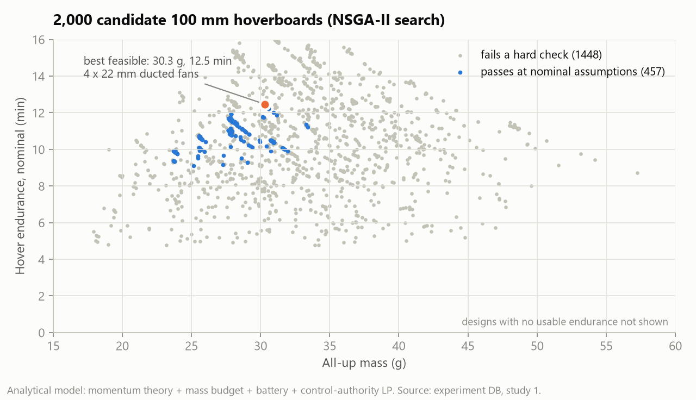

An Optuna NSGA-II study evaluated 2,000 designs on endurance, mass, stability and cost. The design model was first calibrated on a Crazyflie-class drone: it predicts 7.2 min, against a published ~7 min.

| | |
|---|---|
| 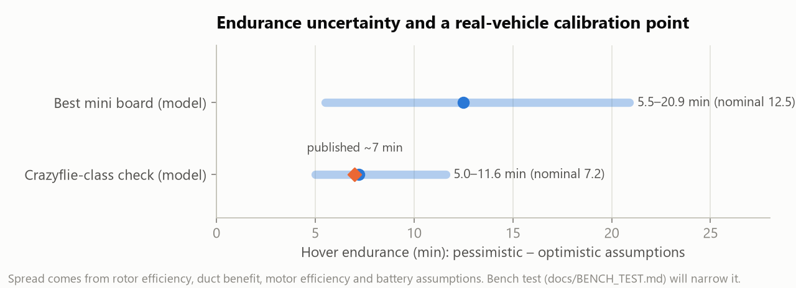 | 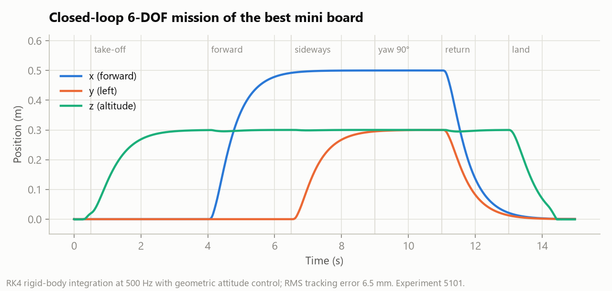 |

The best designs fly a full take-off, translate, yaw and land mission in a closed-loop 6-DOF simulation with 6.5 mm RMS tracking error. The 4× spread in endurance comes from four unmeasured quantities: fan figure of merit, duct benefit, motor efficiency and usable battery energy. The **[bench-test kit](docs/BENCH_TEST.md)** is designed to measure exactly those.

## 2. Ionic wind: verified, then ruled out

| | |
|---|---|
| 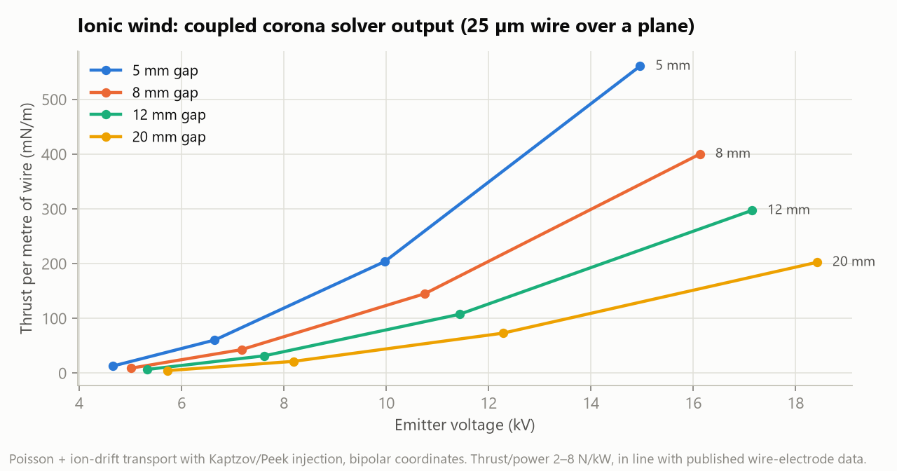 | 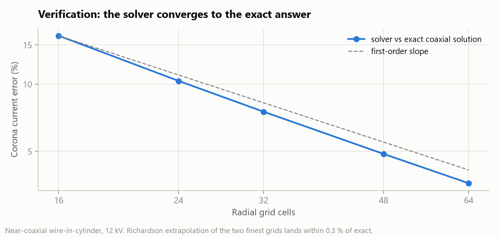 |

A coupled corona-discharge solver (Kaptzov condition, bipolar coordinates) was checked against an exact coaxial solution. Error halves when the grid is refined, as expected, and the Richardson-extrapolated error is 0.3 %. Thrust per kW matches published wire-emitter data.

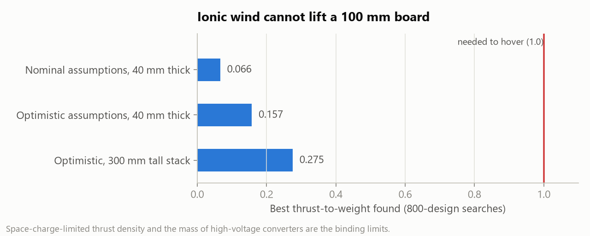

Two things limit it:
- **Thrust density is capped by the square of the electric field,** and the field is limited by air breakdown.
- **The high-voltage converter is too heavy.**

No sensitivity case gets close to lifting the board.

## 3. Scaling to a 200 lb rider

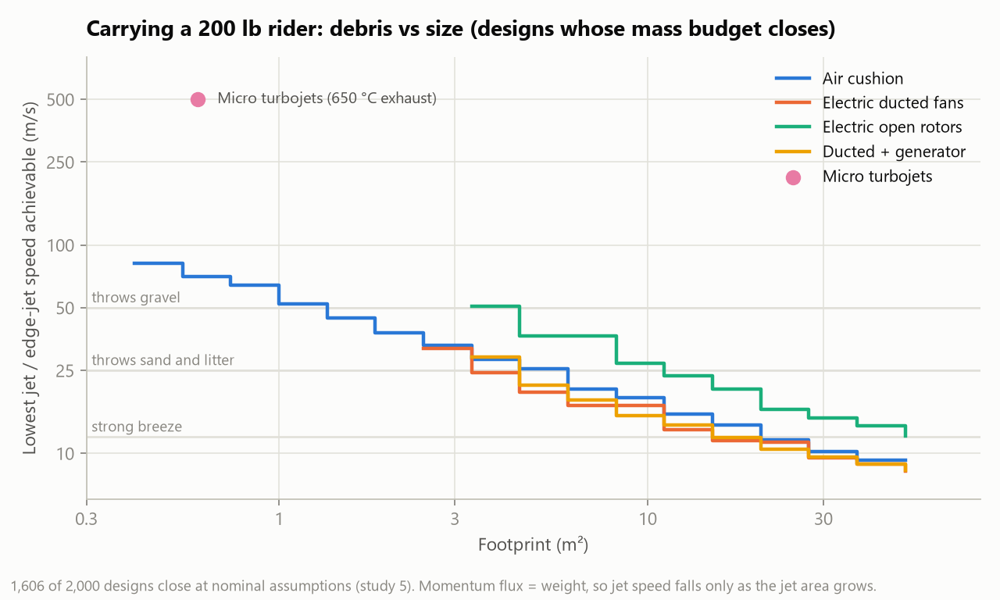

Five concepts went through mass closure, all sized to hold 1.3 × weight with any one lift unit failed:
- battery ducted fans;
- open rotors;
- fans driven by an engine-generator;
- micro turbojets;
- an air cushion.

The debris metric is the speed of the downwash or edge jet. **Only the air cushion is board-sized, still closes under pessimistic assumptions, and keeps the jet to a thin sheet at the skirt edge.**

### The LV-H1 air-cushion board

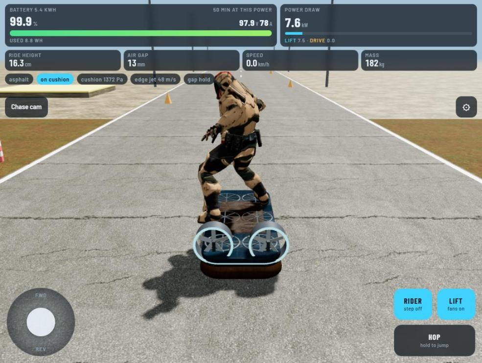

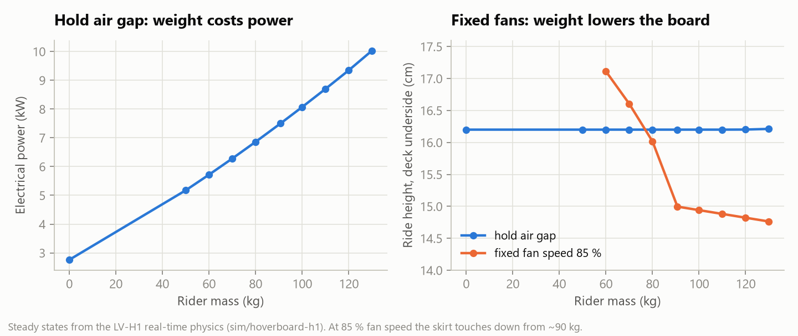

The board is a 1.6 × 0.64 m deck carrying a 24S14P, 5.4 kWh battery. Variable-pitch fans pressurise a skirted plenum, and the physics behind it is:
- the fan curve against skirt leakage;
- plenum pumping damping;
- a Thevenin battery model with current limits.

Things you can try in the sim:
- **Rider on/off.** The deck holds a 12 mm hem gap with or without a rider; power rises from 2.8 kW empty to 7.5 kW with 200 lb aboard.
- **Hop mode.** The board climbs to about 1 m and descends back onto the cushion.
- **Watch the battery.** The pack drains in real time.

## 4. Cold gas and rockets

| Boosted skateboard | Cold-gas hoverboard | Rocket hoverboard (theoretical) |
|---|---|---|
| 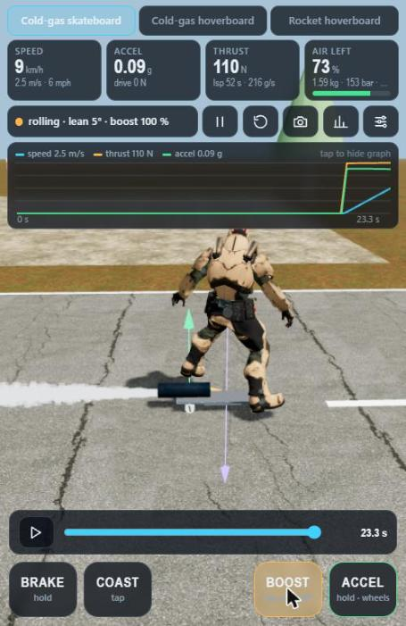 | 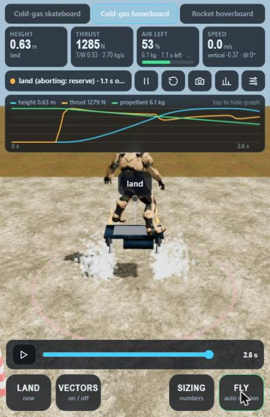 | 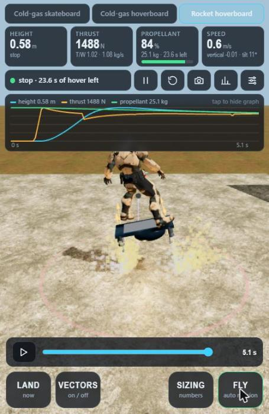 |

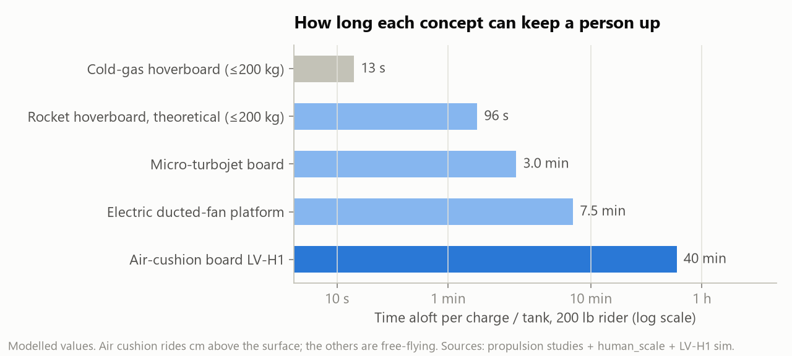

Hover time on stored propellant has a hard ceiling: `t ≤ Isp·ln((1+k)/k)`, where `k` is tank mass per kg of propellant. For compressed air in Type 3 cylinders that is about 23 s, however big the tanks. The cold-gas model uses real-gas properties from CoolProp. The rocket is a black-box Isp model only, with no engine design.

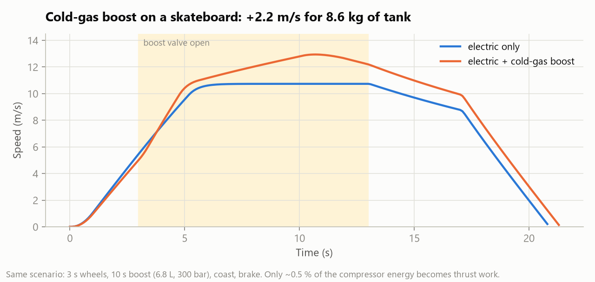

The energy accounting closes to 1e-8 in every run.

**These are simulations only.** No propellant formulations, engine construction or fabrication guidance are included. Any physical test of these ideas must be professionally reviewed, unmanned and contained.

## Repository layout

| Path | Contents |
|---|---|
| `backend/levitate/` | Research harness: rotor and battery physics, RK4 6-DOF + geometric controller, corona solver, screening of 16 lift mechanisms, Optuna studies, human-scale sizing, bench-data analysis, SQLite store, FastAPI |
| `frontend/` | React + Three.js research lab (testing chamber, human scale, propulsion, ionic-wind lab, survey, experiment explorer) |
| `visual-lab/` | Visual flight-physics lab: live 6-DOF over WebSocket, constraint editor, Cantera / Gmsh / scikit-fem integrations |
| `sim/hoverboard-h1/` | LV-H1 browser sim (`site/`) and scenario tests |
| `sim/propulsion/` | Cold-gas and rocket models: Python reference, browser port and tests |
| `docs/` | [Research log](docs/RESEARCH_LOG.md) · [Propulsion experiments](docs/PROPULSION_EXPERIMENTS.md) · [Bench test](docs/BENCH_TEST.md) · [Validation plan](docs/VALIDATION_PLAN.md) · [Solvers](docs/SOLVERS.md) · [API contract](docs/API_CONTRACT.md) |

## Running locally (Windows)

```powershell
.\start.ps1                                   # research API + lab UI at http://127.0.0.1:8000
cd backend; ..\.venv\Scripts\python -m pytest -q   # 80 tests
node sim\hoverboard-h1\test_physics.js        # hoverboard scenario tests
node sim\propulsion\test_propulsion.js        # 79 propulsion tests
```

Regenerate the figures:

```powershell
cmd /c "node docs\figures\sim_data.js > docs\figures\sim_data.json"
.venv\Scripts\python docs\figures\make_figures.py
```

## Honest limitations

- **No measured data yet.** The bench kit (firmware, logger, analysis) is ready, but no hardware has been tested.
- **No CFD.** OpenFOAM and Elmer are not installed, and their adapters report NOT CONNECTED.
- **Skirt leakage is a model.** The hem-gap leakage model needs a scale-model experiment, especially on grass.
- **The rider is a downloaded asset.** The 3D character is the Mixamo "Soldier" from the three.js examples and is loaded at runtime. It is not stored in this repo.

Companion project: **[Project Aether](https://github.com/KyleSau/project-aether)**, a browser rocket-launch simulator.
